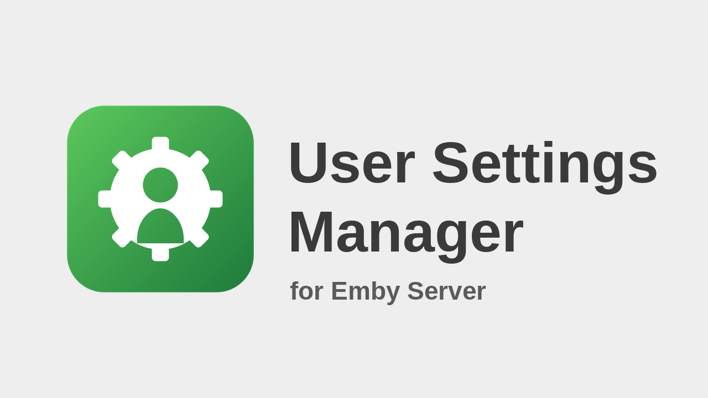
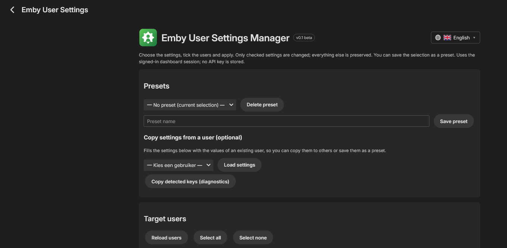
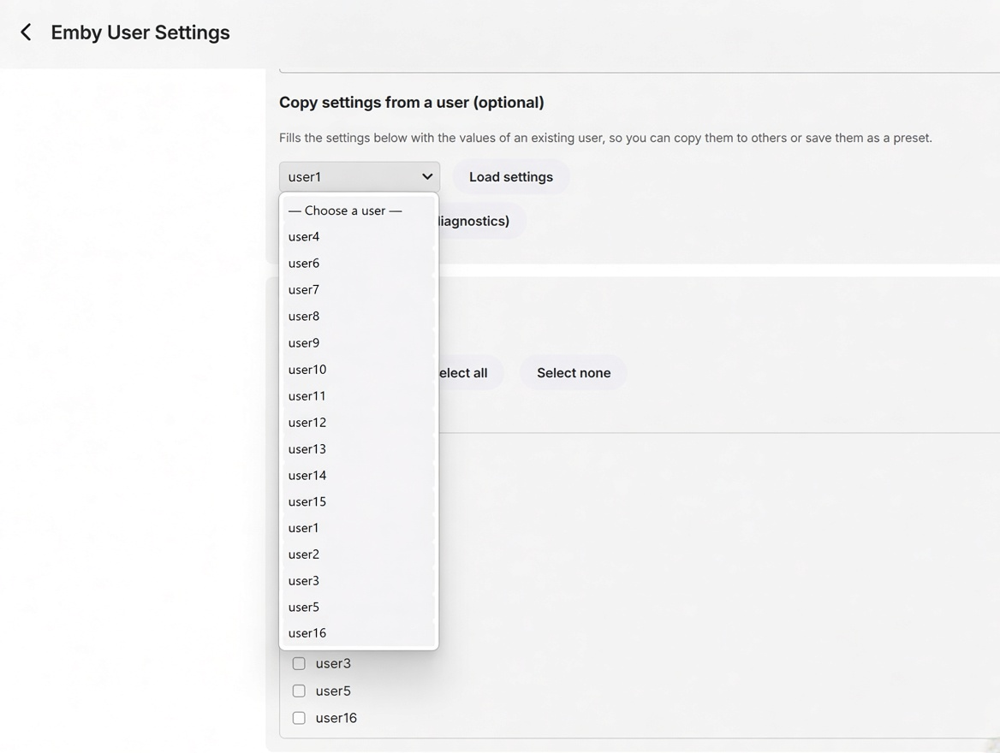
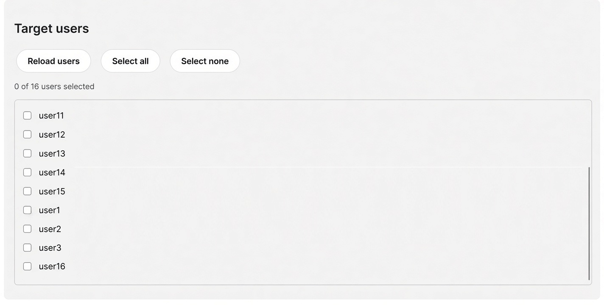

# Emby User Settings Manager —  beta

  

## How it works (beta)

The page mirrors Emby's own user settings pages (Display, Detail screens, Home & library, Sound, Advanced, Subtitles). Everything is checked by default; only checked settings are applied.

1. On open, the plugin reads the stored settings of all users to find out which keys exist on your server (Emby only stores display preferences that were changed). Settings whose key cannot be found are greyed out and are never applied.
2. Tick the target users (nothing is pre-selected) and press Apply. Every change is read back and verified per user.
3. **Presets**: name the current selection and save it; presets are stored on the server in the plugin configuration (`PresetsJson`).
4. Optional: "Copy settings from a user" fills the page with that user's values.
5. "Other settings found (advanced)" lists remaining stored keys under their internal names (unchecked by default).
6. "Copy detected keys (diagnostics)" shows the keys found on your server, which helps map greyed-out settings.

The page is for Emby administrators only: it checks the signed-in user's administrator flag and otherwise shows only a message and makes no changes (Emby's own API also refuses these calls for non-administrators).

User permissions (Profile & account, Playback permissions, Feature access, Access & parental control) are written to the user policy (`Users/{id}/Policy`, field names from the official `UserPolicy` reference). They are unchecked by default and skipped by "Check all". Making users administrators needs an extra confirmation, and you cannot disable your own account or remove your own administrator rights.

Library order is applied as `OrderedViews`; the home sections list is applied as `homesection0..6` (unused slots are set to `none`); the default screen per library as `landing-<libraryId>`. The profile PIN (`ProfilePin`) is optional, unchecked by default and never saved in presets or diagnostics. Credentials (password, PIN) are never copied. Settings Emby keeps only on the device (subtitle appearance etc.), profile picture and notifications cannot be set from a server plugin.

## UI and compatibility

- English and Dutch UI text; detects the dashboard document language first, then browser/app language, with English fallback.
- Responsive CSS for narrow mobile screens and embedded WebViews.
- The page remains a custom HTML/JavaScript UI because it needs user selection, custom apply actions, and verification. See `SDK-COMPATIBILITY.md` for why the official Simple Plugin UI template is not a drop-in replacement.
- The plugin page is registered as a configuration page, without a separate main-menu entry.
- Uses the signed-in Emby dashboard `ApiClient` session; no API key is embedded or stored.

Responsive layout and localization improve the page itself but cannot override an app's policy for which plugin configuration pages it allows. Android's “sign in to your local server directly” message and Windows Theater's layering issue still require app-specific investigation and testing.

## Safe test procedure

1. Back up the currently installed plugin DLL and its configuration.
2. Test the build on a test Emby Server first.
3. Verify the page loads, users load, and a single test user's settings are correctly applied and verified.
4. Only then consider production use. Do not use “all users” until the single-user test passes.
